<div align="center">

# Spaces

### The AI software factory for your team.

**Specs go in. Reviewed, tested pull requests come out.**

[](https://spacesos.dev)
[](https://rayedbajwa.github.io/spaces/)
[](https://bun.sh)
[](docs/concepts/architecture.md)
[](https://github.com/github/spec-kit)
[](LICENSE)

**[Website](https://spacesos.dev) · [Documentation](https://rayedbajwa.github.io/spaces/) · [Getting started](docs/getting-started.md)**

[Quick start](#quick-start) · [How Spaces works](#how-spaces-works) · [What it does](#what-it-does) · [A look around](#a-look-around) · [FAQ](#faq) · [Documentation](#documentation)

<code>research → specify → plan → tasks → implement → review → verify → deliver</code>

<br /><br />

<a href="https://spacesos.dev/blog/what-broke-when-ai-agents-ran-my-software-process">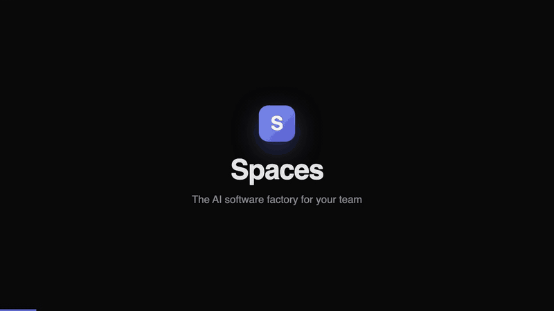</a>

<sub>▶ <a href="https://spacesos.dev/blog/what-broke-when-ai-agents-ran-my-software-process">Watch the one-minute demo</a> · <a href="https://spacesos.dev/blog">Blog</a></sub>

<br />

</div>

---

Have a ticket, a page of requirements or an idea in plain words? Give it to
Spaces. A line of agents, each with one job, turns it into a spec, a plan,
tasks, code, a code review, a QA report and a merged pull request. They know
your codebase, your team's conventions and the tickets behind the work. You
approve at the gates; the factory does the rest.

Every stage leaves an artifact you can read (`spec.md`, `plan.md`,
`tasks.md`, `code-review.md`, `verification-report.md`, `delivery-report.md`),
and the spec is committed alongside the code. A board shows the whole floor:
every card is a feature on the line, with live agent output and the cost of
every run.

Spaces runs on GitHub's [Spec Kit](https://github.com/github/spec-kit) and the
[Pi Coding Agent SDK](https://www.npmjs.com/package/@earendil-works/pi-coding-agent),
and follows the ideas of AWS's
[AI-Driven Development Life Cycle](https://github.com/awslabs/aidlc-workflows):
role-based agents, inception and construction phases, and human approval gates.

> **[Try it at spacesos.dev](https://spacesos.dev)**: registration is by
> invitation for now; join the waitlist on the landing page.

## Quick start

### Run it locally

Prerequisites: [Bun](https://bun.sh) 1.4+ and Docker (for Postgres).

```bash
git clone https://github.com/rayedbajwa/spaces.git
cd spaces
make setup   # .env with a fresh ENCRYPTION_KEY, dependencies, Chromium, Postgres, schema, UI
make up      # web server + supervisor in the background (logs in .run/)
```

Open [http://localhost:3000](http://localhost:3000) and create the first
account; it becomes the owner. `make status` shows the processes and the
queue, `make down` stops everything.

<details>
<summary>Without make</summary>

```bash
cp .env.example .env   # set ENCRYPTION_KEY: openssl rand -base64 48
bun install
bun run db:up
bun run db:migrate
bun run dev            # web UI on http://localhost:3000
bun run worker         # in a second terminal
```

</details>

### Add a model key

Spaces never names a model and ships with no model access. As an owner or
admin, open **Organization → Models** and paste a key from
[Anthropic](https://console.anthropic.com/settings/keys),
[OpenAI](https://platform.openai.com/api-keys) or
[OpenRouter](https://openrouter.ai/settings/keys). It is checked with the
provider, stored encrypted, and picked up by every process within a second.
Spaces sorts what the key unlocks into small, medium and large tiers and routes
each stage to one. See [Getting started](docs/getting-started.md).

### Start your first intent

Connect GitHub from **Integrations** (one click: Spaces creates a GitHub App for
you), press **New project**, and describe the first piece of work:

```text
Add search to the notes list: filter by title and body as you type,
highlight the matches, and keep the query in the URL so it can be shared.
```

Or import a Jira or Linear ticket as the starting point. Spaces clones the
repositories, learns them, and starts the line. You'll be asked to approve the
spec, the plan and the tasks before any code is written.

## How Spaces works

Each feature is an **intent** that moves down the line. Every stage is an agent
with one job; the gates between them are yours.

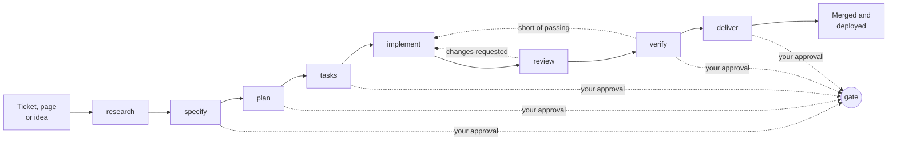

- **Research** picks and clones the repositories a feature needs and reads your
  knowledge base (Confluence, Jira, Linear, GitHub docs) before anything is
  specified.
- **Implement** opens a pull request per workstream and loops through code
  review and QA on its own until both are nearly done. Workstreams that depend
  on each other get stacked pull requests.
- **Verify** runs the tests, drives the app in a headless browser, and writes a
  verification report with a traceability table. What only a person can check
  is listed for you instead of sent back to implement.
- **Deliver** fixes what blocks each pull request (rebase, CI, review comments),
  merges in order once you approve, and confirms the deployment.

Under the hood one image runs in three roles, connected by Postgres, which is
the database, the job queue and the event bus. In production the web service
runs no agents; every project gets its own worker with its own disk, which
sleeps when idle.

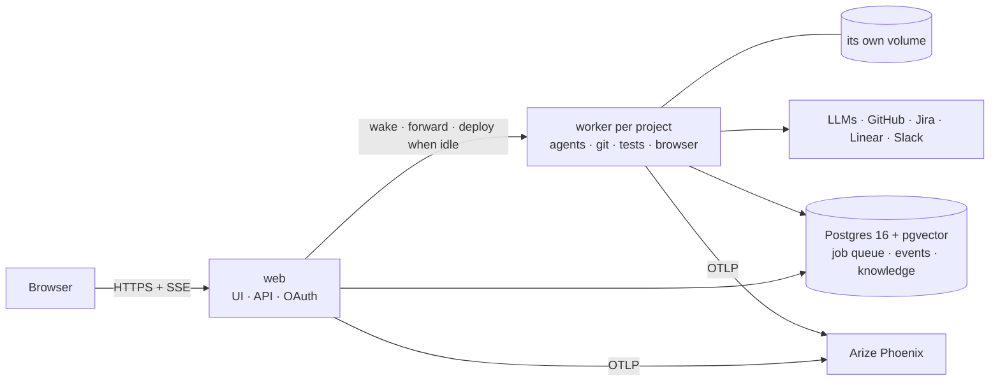

Read [Architecture & scaling](docs/concepts/architecture.md) for the details.

## What it does

| Area | What Spaces gives you | Guide |
|---|---|---|
| Pipelines | Declarative YAML templates: stages, roles, branches, loops, retries and gates | [Pipeline templates](docs/reference/templates.md) |
| Intents | Bug fix, feature, MVP, spike or chore; every document, status and change kept in Postgres and browsable in the app | [Intents](docs/concepts/intents.md) |
| Pull requests | A Conventional-Commits PR per workstream, stacked where workstreams depend on each other, authored by your GitHub App's bot so humans can approve | [Delivery](docs/concepts/delivery.md) |
| Code review and QA | A review posted on the PR with findings by severity; QA that runs tests and a real browser, with screenshots | [Pipelines & stages](docs/concepts/pipelines-and-stages.md) |
| Knowledge | Confluence, Jira, Linear, GitHub docs, web pages and notes, indexed with full-text search and pgvector embeddings for every stage | [Integrations as knowledge](docs/concepts/integrations-and-knowledge.md) |
| Intake | Watch Jira and Linear scopes; new tickets land in a work inbox and become intents in one click | [Inbound intake](docs/concepts/inbound-intake-and-outbound.md) |
| Approvals | Approve in the app, from Slack, or through an emailed link sent to whoever is accountable for the stage | [Organization, teams & access](docs/concepts/organization-teams-and-access.md) |
| Models | Automatic routing by cost and speed across Anthropic, OpenAI and OpenRouter, tuned per organization | [Getting started](docs/getting-started.md) |
| Data guardrails | Secrets and personal data become tokens before anything reaches a model, and are restored only where agents write | [Data guardrails](docs/concepts/data-guardrails.md) |
| Releases | Link a Railway service; approving delivery deploys it and Spaces watches until it is live | [Delivery](docs/concepts/delivery.md) |
| Cost | Tokens and cost per model call, rolled up by stage, run, project and organization | [Agents, workers & context](docs/concepts/agents-and-workers.md) |
| Tracing | A trace per agent turn in Arize Phoenix, with run status, cost and people's gate decisions as annotations | [Configuration](docs/reference/configuration.md#agent-tracing-arize-phoenix) |
| Scale | A worker per project on Railway, Kubernetes or Docker; idle ones sleep, and deploys never interrupt an agent | [Project workers](docs/operations/project-workers.md) |

## A look around

<table>
<tr>
<td width="50%">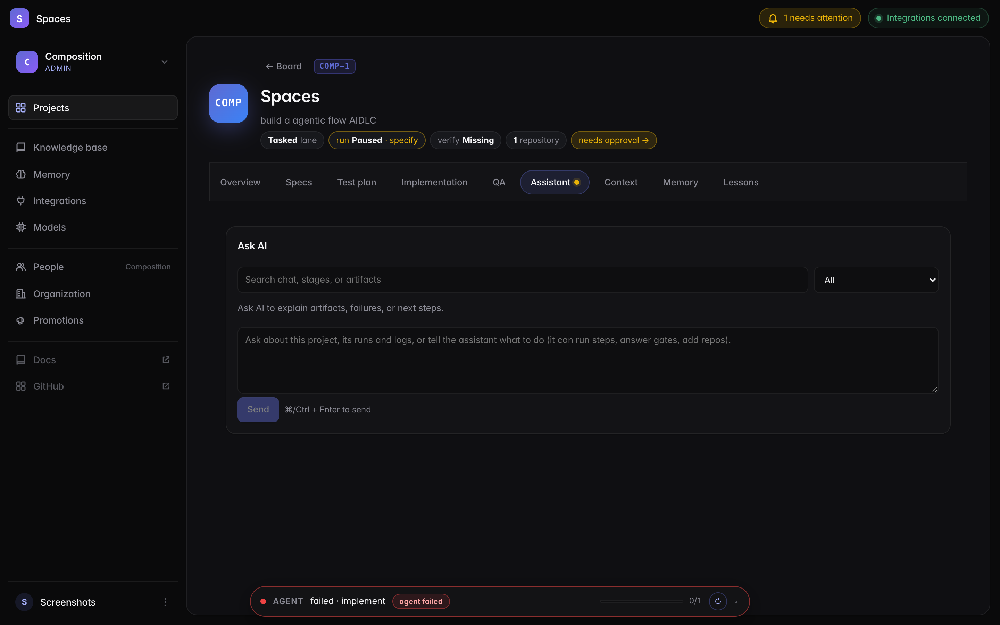<br /><sub><strong>Project page.</strong> Lane, run, verification and repositories at a glance, with the live agent output pinned below.</sub></td>
<td width="50%">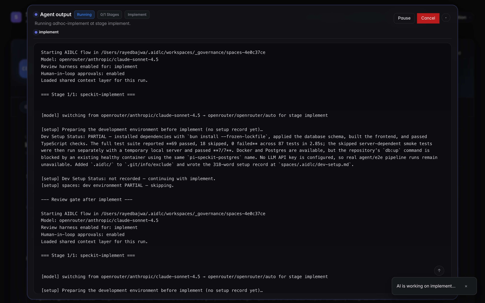<br /><sub><strong>Agent output.</strong> Stage progress, a line per tool call, and approvals and questions when a person is needed.</sub></td>
</tr>
<tr>
<td width="50%">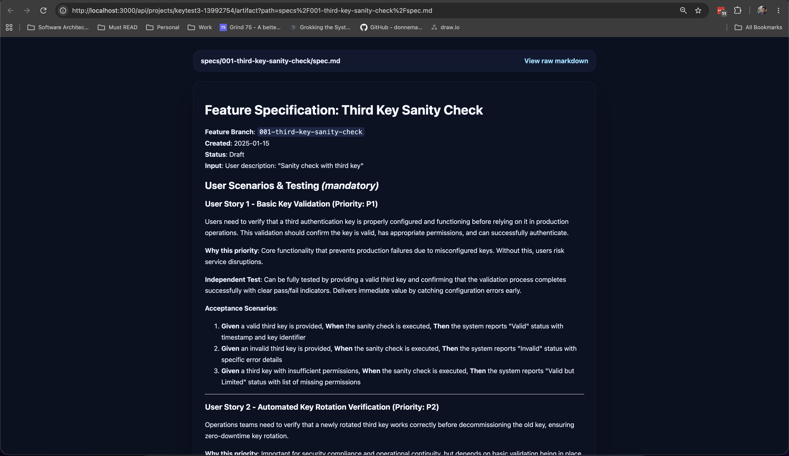<br /><sub><strong>Every artifact, in the app.</strong> Page through an intent's spec, plan, tasks and reports, with their history.</sub></td>
<td width="50%">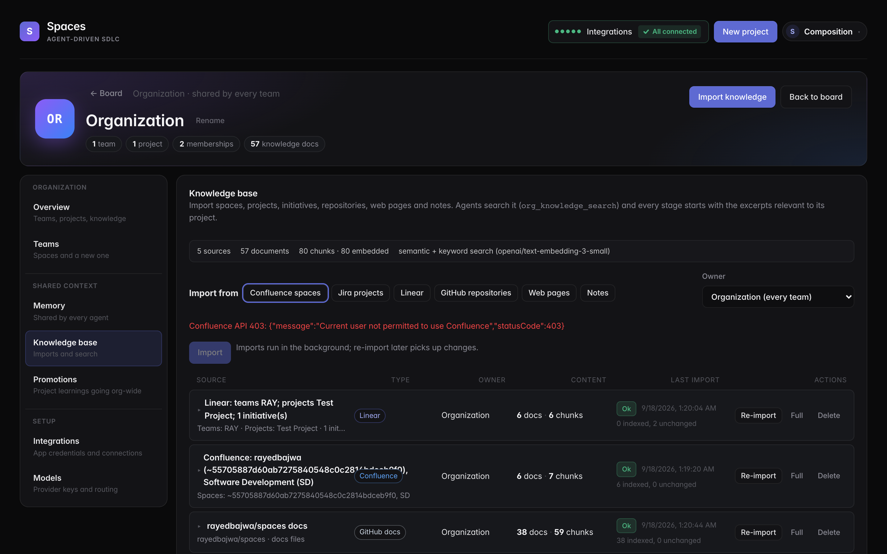<br /><sub><strong>Knowledge base.</strong> Confluence, Jira, Linear and GitHub, searched by every stage.</sub></td>
</tr>
<tr>
<td width="50%">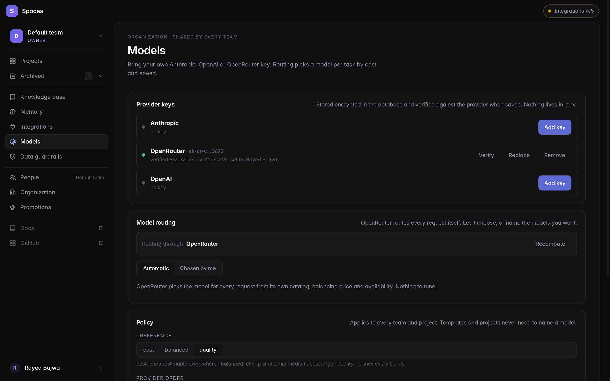<br /><sub><strong>Models.</strong> No model names anywhere: bring a key and set a policy.</sub></td>
<td width="50%">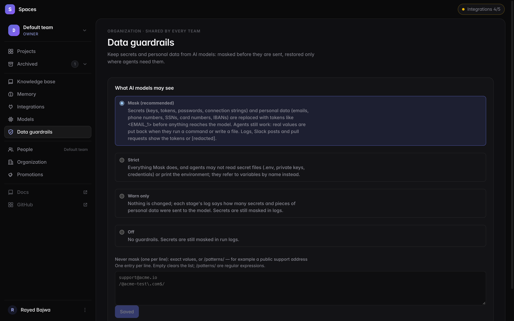<br /><sub><strong>Data guardrails.</strong> Mask, Strict, Warn or Off, per organization.</sub></td>
</tr>
<tr>
<td width="50%">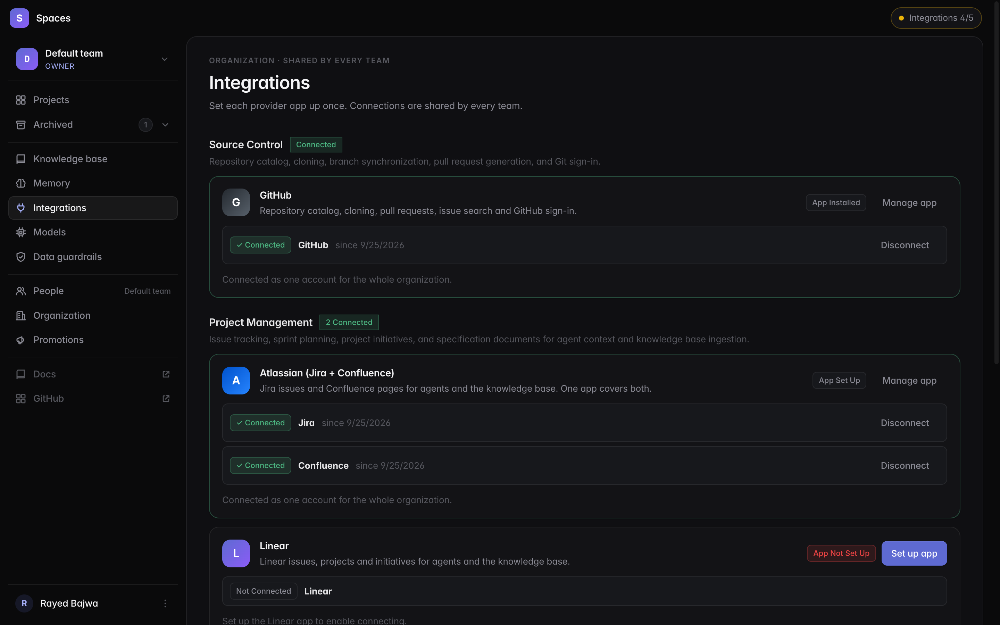<br /><sub><strong>Self-serve integrations.</strong> GitHub, Jira, Confluence, Linear and Slack, set up in the app.</sub></td>
<td width="50%">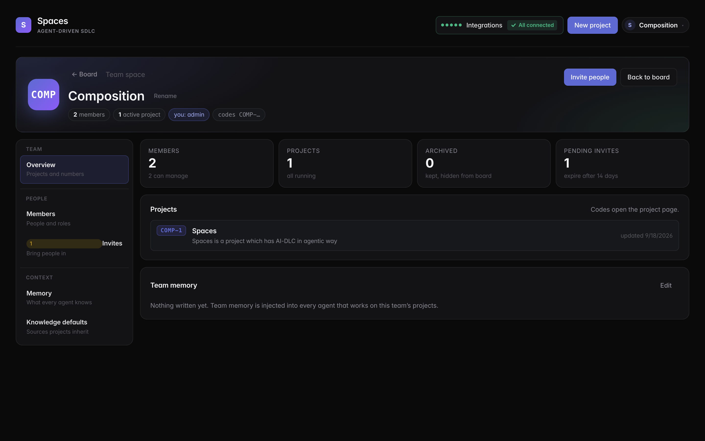<br /><sub><strong>Teams.</strong> Members and roles, invites, team memory and knowledge defaults.</sub></td>
</tr>
</table>

## FAQ

<details>
<summary><strong>Is this a code generator I fire and forget?</strong></summary>

No. Spaces is a workflow runtime with explicit gates. You approve the spec, the
plan, the tasks and the release; agents do the work in between, and every step
leaves a document you can read and change.

</details>

<details>
<summary><strong>Which models does it use?</strong></summary>

Whatever your keys unlock. Spaces reads the provider's catalog, sorts models into
small, medium and large tiers by cost and speed, and routes each stage to one.
An organization policy leans it towards cost or quality, orders providers, and
can pin a tier to an exact model. With OpenRouter, OpenRouter routes each
request itself. Usage is billed by your provider; Spaces adds nothing.

</details>

<details>
<summary><strong>Does my code leave my machine?</strong></summary>

Agents run where Spaces runs: on your machine locally, or on the project's own
worker in production. What reaches a model provider passes through the data
guardrails first, so secrets and personal data are replaced with tokens. The
provider has its own data policy.

</details>

<details>
<summary><strong>Who pushes the code and who approves it?</strong></summary>

With GitHub set up as a GitHub App (the one-click flow), agents push, open pull
requests and merge as the app's bot, so a person can approve them and branch
protection applies to the agent. See [Delivery](docs/concepts/delivery.md).

</details>

<details>
<summary><strong>What if verification never quite passes?</strong></summary>

Accept it. When verification comes close, or what is left needs a person (a
signed build on a device, production keys, a sign-off), the board recommends
**Accept and finish** instead of another implement run. Your note is recorded
with the acceptance. See
[Pipelines & stages](docs/concepts/pipelines-and-stages.md#accepting-a-partial-verification).

</details>

<details>
<summary><strong>How do I run it for a team?</strong></summary>

Deploy a web service and let Spaces create a worker per project on Railway or
Kubernetes, or run everything as one service on a single VM with Docker
Compose. Agents execute code and hold repository tokens, so treat a hosted
instance as a trusted deployment. See
[Deploying to the cloud](docs/operations/cloud-deployment.md) and
[SECURITY.md](SECURITY.md).

</details>

<details>
<summary><strong>Something is stuck. Where do I look?</strong></summary>

[Running & troubleshooting](docs/operations/troubleshooting.md) covers stuck
queues, workers that never sleep and pending updates. Every process logs JSON
lines with a `mod` field naming the module, and the account menu's
**Project workers** page shows each worker's state.

</details>

## Documentation

The full documentation is at **[rayedbajwa.github.io/spaces](https://rayedbajwa.github.io/spaces/)**.

- [Getting started](docs/getting-started.md): install, first account, model keys and the first project.
- [Pipelines & stages](docs/concepts/pipelines-and-stages.md) and [Intents](docs/concepts/intents.md): how work moves down the line.
- [Delivery](docs/concepts/delivery.md): pull requests, code review, merging, deployment and UAT.
- [Integrations as knowledge](docs/concepts/integrations-and-knowledge.md) and [Inbound intake](docs/concepts/inbound-intake-and-outbound.md): GitHub, Jira, Confluence, Linear and Slack.
- [Architecture & scaling](docs/concepts/architecture.md): roles, the job queue, workers and failure modes.
- [Configuration](docs/reference/configuration.md), [HTTP API](docs/reference/api.md) and [Pipeline templates](docs/reference/templates.md).
- [Deploying to the cloud](docs/operations/cloud-deployment.md) and [Project workers](docs/operations/project-workers.md).

Report vulnerabilities through [SECURITY.md](SECURITY.md).

## Contributing

Issues and pull requests are welcome. See [CONTRIBUTING.md](CONTRIBUTING.md) for
the development setup, conventions and checks. `bun test` only writes to a test
database (see
[Configuration](docs/reference/configuration.md#running-the-test-suite)).

## License

Personal, non-commercial use only; no redistribution. See [LICENSE](LICENSE).
