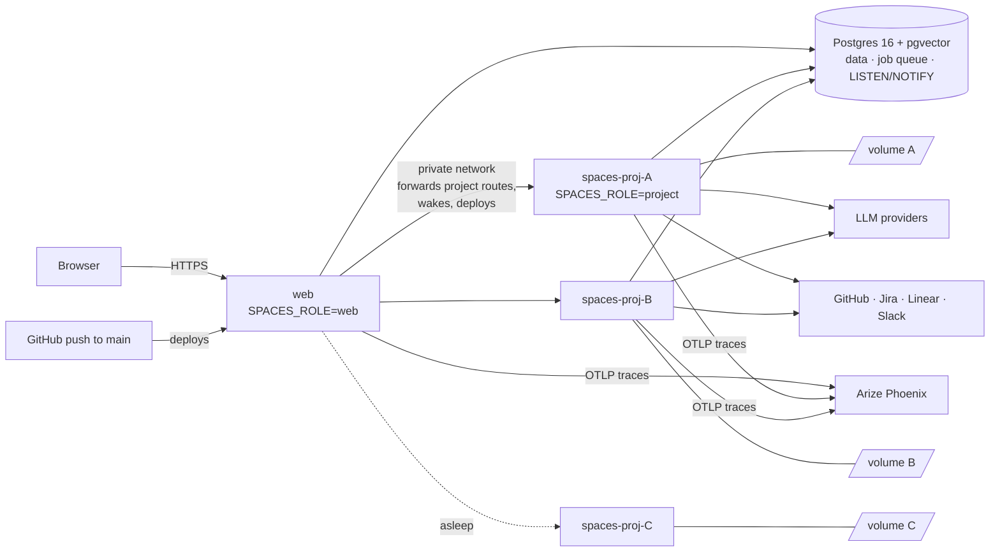
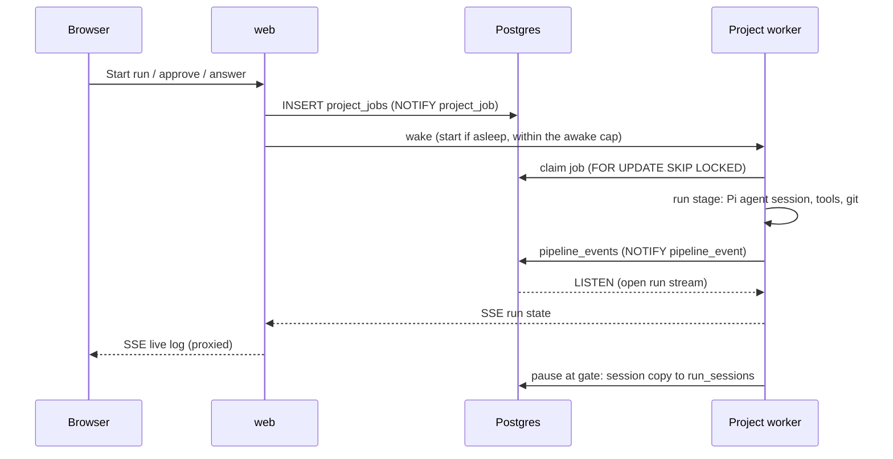

# Architecture & scaling

Spaces is one codebase and one container image that runs in three **roles**,
chosen by `SPACES_ROLE`. Postgres connects them: it is the database, the job
queue and the event bus. The design is in `specs/014-project-workers`.

| Role | Runs | Disk | Use it for |
|---|---|---|---|
| `all` (default) | Web server + supervisor, which spawns a job worker per active project, all in one service | One `/data` volume shared by everything | Local development, a single VM, small teams |
| `web` | Web UI, JSON API, SSE streams, OAuth callbacks, the provisioner, wake/sleep and rollouts | None | Production: the public service |
| `project` | The same server code for **one** project, plus that project's job worker | The project's own `/data` volume | Production: one per project |

`bun run src/standalone.ts` is the entry point for every role. It starts the
server, then the supervisor (`all`) or the project's job worker (`project`),
and stops the service if either dies so the platform restarts it.

## Production layout: a worker per project

- **The web service has no workspace disk.** Project routes that may touch
  files, git or an agent are forwarded to the project's worker over the private
  network, with the session cookie and an internal token
  (`SPACES_INTERNAL_TOKEN`). Routes that only need the database (the board,
  usage, jobs, the project's settings) stay on the web service, so browsing
  never wakes a worker.
- **Each project worker** is a service named `spaces-proj-<code>` with its own
  volume holding the project's clones, governing workspace, worktrees and agent
  sessions. It only claims its own project's jobs.
- **Deploying the web service never interrupts agents.** The agents run on
  the workers, which are updated separately when idle (below).
- **Projects don't compete for one machine.** A busy project's tests, builds and
  Chromium use its own CPU, memory and disk.

The web service creates a project's worker the first time the project needs
one: when the project is created, or when it is first opened or run. It records
each step (service, volume) as it completes, so a failed provisioning resumes
instead of duplicating. Railway, Kubernetes and Docker are supported; see
[Project workers](../operations/project-workers.md).

## How work flows

1. **Queue.** Every job is a row in `project_jobs`, claimed with `SKIP LOCKED`
   and limited by the project's `max_concurrent`. Every insert notifies
   `project_job`, whichever path queued it (a run, an approval link, a Slack
   answer, an intake conversion).
2. **Wake.** The web service listens there and wakes that project's worker. A
   sweep every 30 seconds catches anything missed.
3. **Run.** The worker runs the stage with the
   [Pi Coding Agent SDK](https://www.npmjs.com/package/@earendil-works/pi-coding-agent),
   writing events (log chunks, usage, status) to `pipeline_events`.
4. **Stream.** A run's live log is an SSE stream from the project's worker,
   proxied by the web service. The worker pushes the run's state on each
   `pipeline_event` notification. If the stream drops (a deploy, a restart),
   the page reconnects with backoff and gets the run's full state again.
5. **Pause.** At a gate the worker keeps nothing in memory. It stores the agent
   session (gzipped) in `run_sessions` and lets the engine go. An answer queues
   a job that reopens the session where it stopped, on any worker, even after a
   restart or on a new volume.

## Sleeping, waking and the awake cap

Idle workers cost nothing to keep:

- A worker's job process exits after `PROJECT_WORKER_IDLE_SECONDS` (300) with
  nothing to do. That includes runs waiting on a person.
- **Railway** then sees no traffic and puts the service to sleep, about ten
  minutes later. A request from the web service wakes it.
- **Kubernetes** has no sleep, so the web service scales a quiet worker's
  Deployment to 0 after `PROJECT_WORKER_SLEEP_SECONDS` (600) and back to 1 when
  it's needed. The PersistentVolumeClaim keeps its files.
- At most `PROJECT_WORKERS_MAX_AWAKE` (5) workers run jobs at once. Other
  projects' work waits in the queue until one goes idle, and the super admin
  gets a Slack DM when the cap is hit.

## One deployment path

A push to `main` deploys the web service, and only the web service deploys
workers:

- The web service's version is the git commit it was built from
  (`GIT_COMMIT`).
- Every minute it moves idle workers on another version to it, two at a time.
  A worker that's running something stays on its version until the stage ends.
- A worker the platform has put to sleep isn't started just to update it.
  When work wakes it, it's deployed on the current version first.
- On Railway workers have no branch and no deployment trigger. Spaces removes
  any trigger Railway attaches, so a merge can't wake every worker.

## Observability

- **Logs:** JSON lines on stdout from every process. `mod` names the module,
  for example `worker-wake`, `worker-rollout` or `project-forward`.
- **Workers:** the account menu → **Project workers** shows each worker's
  state, version, whether it's awake, pending updates and projects waiting at
  the cap. `GET /api/workers` lists live job processes and their heartbeats.
- **Agent traces:** with `PHOENIX_COLLECTOR_ENDPOINT` set, every agent turn is a
  trace in [Arize Phoenix](https://arize.com/phoenix/): an AGENT span with the
  LLM call (model, tokens, cost) and a span per tool call. Each run is a Phoenix
  session. Run status, run cost and people's gate decisions are recorded as
  annotations on it, and `bun run phoenix:evals` keeps datasets and evaluators
  for what Spaces expects of its agents. Text is masked by the
  [data guardrails](data-guardrails.md) before it leaves. See
  [Configuration](../reference/configuration.md#agent-tracing-arize-phoenix).

## Scaling

| Dimension | What limits it | How to scale |
|---|---|---|
| Projects | One worker service and volume each; sleeping ones use no compute | Effectively unbounded; storage is the cost |
| Concurrent projects | `PROJECT_WORKERS_MAX_AWAKE` (5) | Raise it to what the platform's CPU, memory and budget allow |
| Work inside a project | The project's `max_concurrent`, and the worker's size | `PROJECT_WORKER_VCPUS`, `PROJECT_WORKER_MEMORY_GB` (2 / 2), `PROJECT_WORKER_DISK_GB` |
| Web traffic | One web instance (`numReplicas: 1`); it serves the UI and proxies project requests, and runs no agents | State lives in Postgres, so the web service is light. Running more replicas is untested: the wake, sleep and rollout loops assume one |
| Postgres connections | Each process pools up to 10 (idle ones close after 30 s) | Budget 10 for web + 20 per awake worker (its server and job process); with 5 awake that's about 110. Use PgBouncer in **session** mode if needed (transaction mode breaks `LISTEN/NOTIFY` and advisory locks) |
| Postgres size | `pipeline_events` grows with every stage | Prune old runs' events; managed Postgres 16 with pgvector |
| Model spend | Provider rate limits and cost | Model routing by tier, per-organization policy; cost per run is recorded |

**In the `all` role** everything shares one machine: `SUPERVISOR_MAX_WORKERS`
(4) caps the per-project job processes, each about 300–500 MB plus whatever its
tests and builds use. A worker whose project has no work left gives its slot to
a waiting project at once. This is the simplest setup, but a deploy restarts
the agents with it (they drain up to `RAILWAY_DEPLOYMENT_DRAINING_SECONDS` /
`SPACES_DRAIN_SECONDS` first), and every project shares one disk.

## Failure modes

| Failure | What happens |
|---|---|
| Web service deploys or restarts | Agents carry on; open pages reconnect their live logs and get the run's full state |
| A worker restarts mid-stage | The run is re-queued from that stage and resumes the agent's session |
| A worker's volume is lost | Agent sessions come back from `run_sessions` and intent documents from the database; repositories are cloned again |
| A worker stops heartbeating | Its jobs are closed and its runs handed back to the queue |
| Provisioning fails halfway | The recorded steps let the next attempt resume; the Project workers page shows the error |
| An update isn't reported within 20 minutes | The rollout tries again |
| Postgres is down | Everything stops; nothing is lost that was committed. Use a managed database with point-in-time recovery |

## Code map

| Path | What it does |
|---|---|
| `src/standalone.ts` | Entry point for every role: server plus supervisor or job worker |
| `src/server.ts` | Bun HTTP server: UI, API, SSE, OAuth; applies the schema at boot |
| `src/worker.ts`, `src/supervisor.ts` | Job worker; per-project process supervisor for the `all` role |
| `src/lib/role.ts`, `src/lib/project-forward.ts` | Roles; forwarding project routes from web to worker |
| `src/lib/worker-provisioner.ts`, `src/lib/worker-platform-*.ts` | Creating and removing workers on Railway, Kubernetes and Docker |
| `src/lib/worker-wake.ts`, `src/lib/worker-sleep.ts` | Waking for queued work within the awake cap; Kubernetes scale-to-zero |
| `src/lib/worker-rollout.ts` | Updating idle workers to the web service's version |
| `src/lib/project-migration.ts` | Moving a project's files between the shared disk and its worker |
| `src/lib/dispatcher.ts` | Job queue with per-project concurrency |
| `src/lib/pipeline-engine.ts`, `src/lib/aidlc.ts` | Running pipeline templates on the Pi SDK |
| `src/lib/agent-pool.ts` | Warm agent sessions reused across runs |
| `src/lib/tracing.ts`, `src/lib/phoenix-*.ts`, `src/lib/agent-evals.ts` | Phoenix traces, annotations, provisioning and evaluations |
| `src/lib/guardrails.ts`, `src/lib/crypto-vault.ts` | Data guardrails; AES-256-GCM sealing of stored keys and tokens |
| `src/lib/db-schema.sql` | The schema, idempotent DDL applied at boot |
| `deploy/kubernetes/` | Namespace, web Deployment, RBAC for the provisioner, dev Postgres |
| `Dockerfile`, `Dockerfile.web` | Worker image (git, Chromium, psql) and the slimmer web image |
